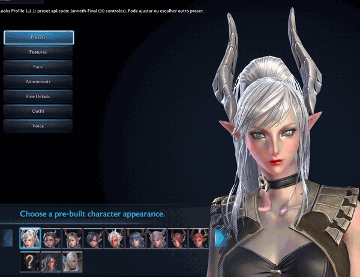
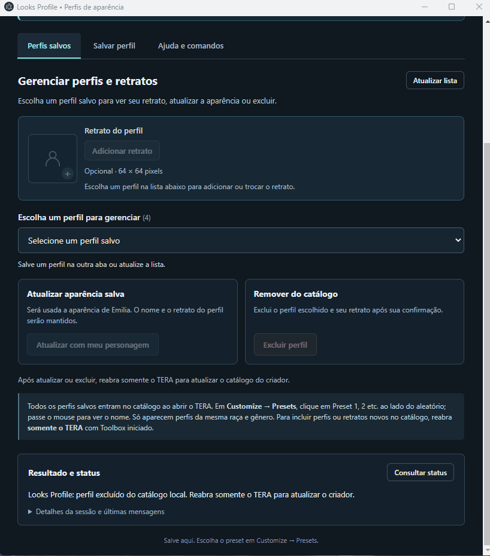
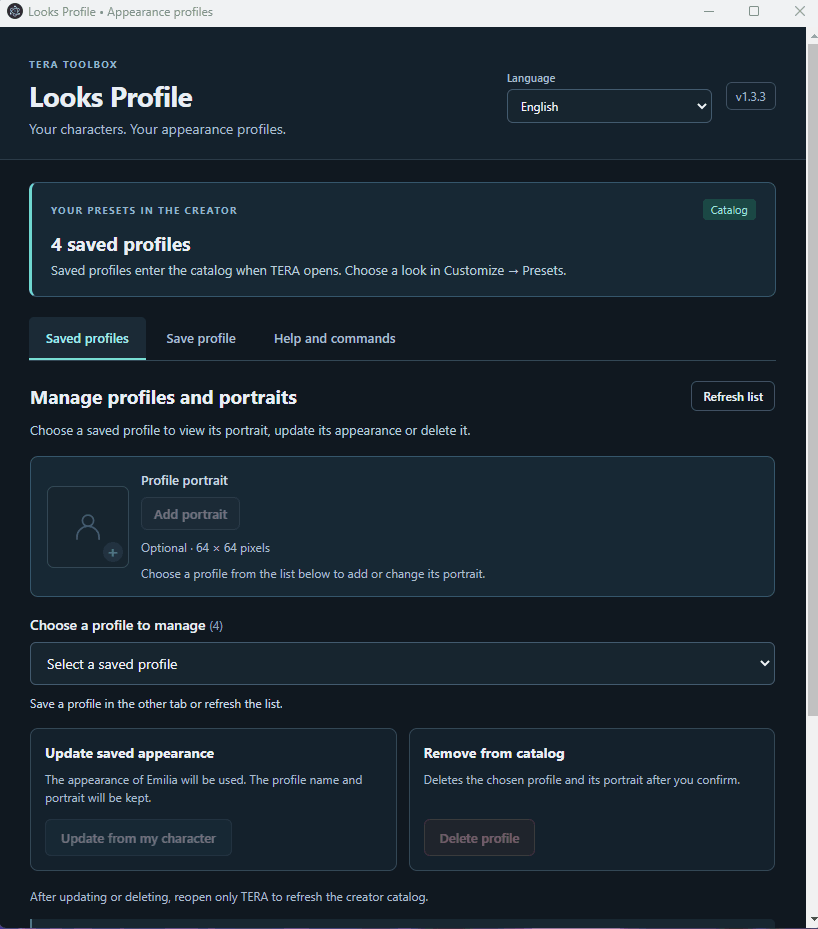

# Looks Profile

Salve a aparência dos seus personagens do TERA, incluindo cabelo, rosto, cores e ajustes de **Fine Details**. Escolha os perfis direto em **Customize → Presets**, com retratos opcionais.

## Comandos

| Comando | Função |
| --- | --- |
| `!lookprofile` | Abrir a janela de perfis. Atalho **Ctrl+Alt+L**. |
| `!lookprofile save self Nome do perfil` | Salvar seu personagem pelo chat. |
| `!lookprofile status` | Consultar o status do catálogo. |
| `!lookprofile reload` | Atualizar a lista da janela. |

## Instalação

1. Coloque a pasta `looks-profile-manager` em `tera-toolbox/mods`. Se baixou o ZIP, dê esse nome à pasta extraída.
2. Abra o Toolbox em modo gráfico e depois inicie o TERA.

**Compatibilidade** · TERA 100.2 para PC x64, com interface original compatível. Para o Phoenix, use a edição Looks Profile Phoenix.

## Como usar

1. Dentro do jogo, pressione **Ctrl+Alt+L** ou digite `!lookprofile`.
2. Em **Salvar perfil**, escolha **Meu personagem**. Para salvar um personagem da sua seleção ou um jogador visível no mapa, use **Outro personagem pelo nome** e informe o nome exato. Se deixar o nome do perfil em branco, o mod usa o nome do personagem.
3. Reabra somente o TERA, com o Toolbox aberto. No criador, vá a **Customize → Presets**. Os perfis da mesma raça e gênero aparecem ao lado do botão aleatório, mesmo que sejam de outra classe. Passe o mouse para ver o nome e use as setas para navegar.
4. Clique no perfil, aguarde a mensagem de conclusão e confira o visual antes de ajustar os controles ou confirmar a aparência.

**Troca de aparência por item** · A partir da versão 1.3.6, você também pode escolher um perfil em **Customize → Presets** na tela aberta pelo item.

**Adicionar ou trocar retrato** · Use **Adicionar retrato** ao salvar ou selecione um perfil em **Perfis salvos**. Escolha uma imagem PNG ou JPEG, ou cole uma captura. Enquadre o rosto e clique em **Usar este recorte**.

**Atualizar um perfil** · Dentro do mundo, selecione-o em **Perfis salvos**, clique em **Atualizar com meu personagem** e confirme. O perfil mantém o nome e o retrato.

**Excluir um perfil** · Em **Perfis salvos**, selecione-o, clique em **Excluir perfil** e confirme. O perfil e seu retrato são removidos. Reabra somente o TERA após salvar, atualizar, excluir ou trocar o retrato para refletir a mudança em **Presets**.

**Transferir perfis** · Copie os arquivos JSON para `profiles` e os retratos PNG correspondentes para `icons`, mantendo os nomes.

## Janela de perfis

No menu **Idioma**, escolha português, inglês, espanhol latino-americano ou **Automático** para usar o idioma do sistema. A preferência fica salva.

### Português

### Inglês

